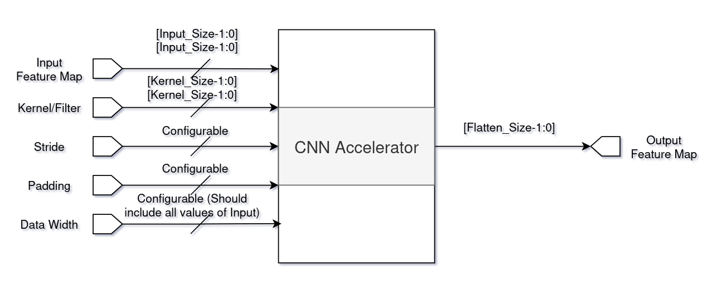

# Theory of Operation

The CNN Accelerator is a **hardware implementation of a convolutional neural network**. It performs **all major CNN operations in hardware**, including convolution, activation, pooling, flattening, and classification. This enables **low-latency inference** on edge devices or FPGAs.

## Data Flow

```
Input → Convolution + ReLU → MaxPooling → Flatten → GAP → Argmax → Output
```

* **Input:** The accelerator receives a multi-channel image or feature map, formatted in fixed-point or integer representation.
* **Convolution + ReLU:** Feature extraction via learned filters, followed by non-linear activation.
* **MaxPooling:** Downsamples feature maps while retaining the most important spatial features.
* **Flatten:** Converts 2D feature maps into a 1D vector for fully connected or global pooling layers.
* **Global Average Pooling (GAP):** Reduces each feature map to a single value, reducing the number of parameters.
* **Argmax:** Determines the class label corresponding to the highest probability.
* **Output:** The predicted classification result.

## Architecture Overview



The system consists of **modular, parameterized units**, enabling reuse and scalability.

### 1. conv.sv – 2D Convolution + ReLU Activation

* Implements **2D convolution** over multi-channel inputs with configurable kernel size, stride, and padding.
* Performs **element-wise multiplication and accumulation (MAC)** for each kernel.
* Applies **ReLU activation**, replacing negative values with zero.
* **Hardware optimization:** pipelined MAC operations and parallel kernels.
* **Role:** Extracts spatial features such as edges, textures, or patterns.

### 2. mac.sv – Multiply-Accumulate Unit

* Performs **`sum += input × weight`**.
* Optimized for **fixed-point arithmetic**.
* Supports **parallel channels**.
* **Role:** Core computation engine for convolution and pooling.

### 3. maxpool.sv – 2×2 Max Pooling

* Takes a **2×2 window** of inputs and outputs the **maximum value**.
* Stride = 2, reducing feature map dimensions by half.
* **Role:** Downsampling and feature selection.

### 4. flatten.sv – Flattening Module

* Converts a **2D feature map into a 1D vector**.
* Maintains **channel and spatial order**.
* **Role:** Prepares data for fully connected layers or GAP.

### 5. gap.sv – Global Average Pooling

* Computes the **average of each feature map**, collapsing H×W dimensions.
* Reduces **parameters** and prevents overfitting.
* **Role:** Provides **global summary features** for classification.

### 6. argmax.sv – Classification Output Logic

* Receives the output vector from GAP or fully connected layers.
* Compares all elements to find the **index of the maximum value**.
* Outputs this index as the **predicted class label**.
* **Hardware:** Comparator trees for efficiency.
* **Role:** Final decision-making stage.

## Summary

The CNN Accelerator pipeline is designed for **high-throughput, low-latency inference**. Each module is **modular, parameterized, and pipelined**, enabling:

* Parallel computation
* Efficient resource utilization
* Flexibility to scale for larger CNN models

By combining convolution, activation, pooling, flattening, GAP, and argmax in hardware, the accelerator **mirrors standard CNN processing** while delivering the speed advantages of dedicated hardware.
