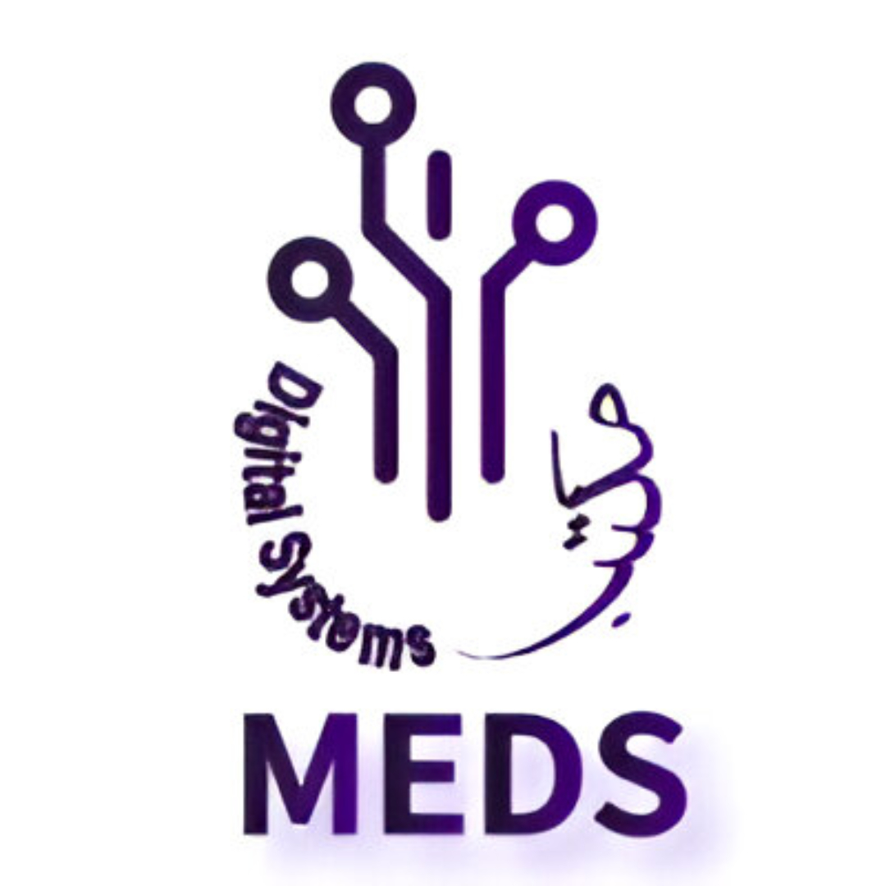

# CNN Hardware Accelerator

<p align="center">
  
</p>

[](https://github.com/meds-uet/CNN-Accelerator/blob/main/LICENSE)
[](https://cnn-accelerator-docs.readthedocs.io/en/latest/)


A fully parameterized **Convolutional Neural Network (CNN) accelerator** implemented in **SystemVerilog**, designed for FPGA and ASIC deployment.

---

## Key Features

- Modular RTL design: Convolution, ReLU, MaxPooling, Flatten, GAP, and Argmax blocks  
- FSM-controlled operation  
- Parameterized image size, kernel size, and data width  
- Supports real-image testbench for hardware-level verification  
- Efficient FPGA resource utilization  
- Configurable for various embedded AI workloads  

---

## Top-Level Architecture

<p align="center">
  
  <br>
  <em>Figure: System-level CNN Accelerator pipeline.</em>
</p>

**Processing Flow:**  
`Input → Convolution + ReLU → MaxPooling → Flatten → GAP → Argmax → Output`

---

## Quick Start

```bash
# Clone the repository
git clone https://github.com/meds-uet/CNN-Accelerator.git
cd CNN-Accelerator

# Run a basic simulation (ModelSim / Questa / Vivado)
make sim
```

To modify global parameters, edit:
```systemverilog
# File: rtl/cnn_defs.svh
parameter int DATA_WIDTH = 8;
parameter int IFMAP_SIZE = 128;
parameter int KERNEL_SIZE = 3;
parameter int STRIDE = 1;
parameter int PADDING = 1;
```

---

## Full Documentation

Complete documentation — including **architecture theory**, **module descriptions**, **signal references**, and **simulation setup** — is available on **ReadTheDocs**:

🔗 [https://cnn-hardware-accelerator.readthedocs.io](https://cnn-hardware-accelerator.readthedocs.io)

---

*Developed by [Maktab-e-Digital Systems Lahore](https://github.com/meds-uet)*  
**Authors:** Abdullah Nadeem & Talha Ayyaz  
**License:** Apache License 2.0  
**Date:** July/August 2025
